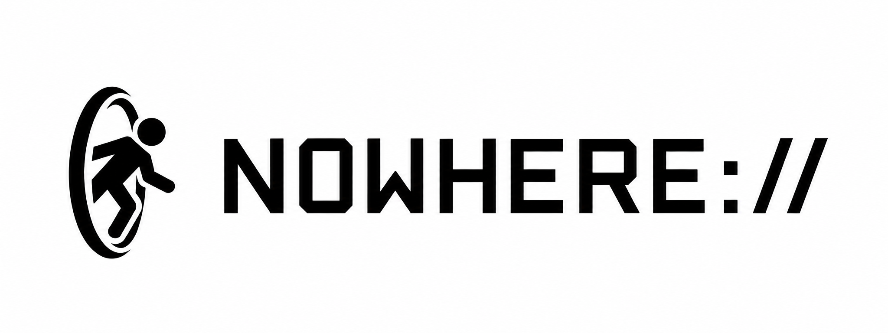

<p align="center">
  
</p>

<p align="center">
  <strong>Secure transport. Flexible exits.</strong>
</p>

<p align="center">
  TCP and UDP relay over TLS and QUIC.
</p>

<p align="center">
  <a href="#get-connected">Get connected</a> &middot;
  <a href="#ecosystem">Ecosystem</a> &middot;
  <a href="#architecture">Architecture</a> &middot;
  <a href="#observability">Observability</a> &middot;
  <a href="docs/README.md">Documentation</a> &middot;
  <a href="docs/protocol.md">Wire protocol</a>
</p>

Nowhere gives TCP and UDP traffic a secure path to the exit you choose.
Run it close to your applications, on a public relay, or at a remote exit.
One Rust binary provides **Portal**, **Vector** and **Egress**.

| Capability | What you get |
|---|---|
| Encrypted transport | TLS or QUIC for TCP and UDP traffic |
| Exit placement | Direct access, a SOCKS5 upstream or a remote Egress |
| Standard ingress | Connect applications through SOCKS5 |
| Optional Morph | Shared-key masking of the transport wire image |
| Operational visibility | Local status and structured telemetry |

## Get connected

Start with a stable Rust toolchain and a reachable Portal host.

### 1. Build

```bash
cargo build --release --locked
```

### 2. Create a key

Use the generated value for `<generated-key>` on both peers:

```bash
./target/release/nowhere generate-key
```

### 3. Run Portal

Listen on port `2000`; allow both TCP and UDP through the firewall:

```bash
./target/release/nowhere "portal://<generated-key>@*:2000"
```

### 4. Verify the certificate

Compare this fingerprint with Portal's trusted startup log, then set `pin=<sha256>`:

```bash
./target/release/nowhere fingerprint "nowhere://<generated-key>@portal.example:2000?morph=1"
```

### 5. Connect applications

Run Vector, then point applications at SOCKS5 `127.0.0.1:1080`:

```bash
./target/release/nowhere \
  "vector://<generated-key>@portal.example:2000?pin=<sha256>&in=127.0.0.1:1080"
```

### 6. Read local statistics

Run on either host to inspect its local instances:

```bash
./target/release/nowhere status
```

## Ecosystem

Connect, deploy and operate with focused tools. Interfaces and integration
requirements are documented in the [ecosystem guide](docs/ecosystem.md).

| Project | Purpose | Get started |
| --- | --- | --- |
| [Anywhere](https://github.com/NodePassProject/Anywhere) | Native connections on Apple platforms | [App Store](https://apps.apple.com/us/app/id6758235178) |
| [nowhere-sh](https://github.com/NodePassProject/nowhere-sh) | Linux deployment and service management | [Quick start](https://github.com/NodePassProject/nowhere-sh#quick-start) |
| [OpenCtrl](https://github.com/NodePassProject/OpenCtrl) | Process control through REST and SSE | [API reference](https://github.com/NodePassProject/OpenCtrl/blob/main/docs/master.md) |
| [NowhereDash](https://github.com/NodePassProject/NowhereDash) | Fleet operations from a web dashboard | [Quick start](https://github.com/NodePassProject/NowhereDash#quick-start) |

## Architecture

Vector connects applications to Portal. Portal forwards directly, through SOCKS5,
or through an Egress that connects back to it. Arrows show connection establishment;
traffic travels in both directions.

```text
+----------+   TLS / QUIC    +----------+  Direct / SOCKS5  +----------+
|  Vector  |---------------->|  Portal  |------------------>|  Target  |
+----------+                 +----------+                   +----------+
                                   ^
                                   | TLS / QUIC
                             +----------+     TCP / UDP     +----------+
                             |  Egress  |------------------>|  Target  |
                             +----------+                   +----------+
```

### One endpoint grammar

Configure each role with a URL. Portal declares one or two listener carriers;
Vector and Egress each select one carrier. Choose ports and address
families through the endpoint path. See [Configuration](docs/configuration.md).

### Connection and flow

Ingress and exit can live on different hosts. Egress opens an outbound connection,
so its host needs no inbound relay port. See [Architecture](docs/egress.md)
for the connection model.

## Wire design

Connection-bound authentication and explicit Flow setup give every transfer a
clear beginning and lifetime. The [protocol reference](docs/protocol.md) links
the Core contract and documents Nowhere's extensions.

### Wire masking

Morph is enabled by default (`morph=1`) for shared-key masking below TLS and QUIC.
Use `morph=0` to disable it. TLS/QUIC provides certificate verification and
authenticated encryption. Morph TCP carries bootstrap authentication data
through the [Prelude Extension](docs/prelude.md).

### Remote exits

Place target access where it belongs. With `out=egress`, independent registered
TLS and QUIC exits serve Portal's clients. Follow the [Egress guide](docs/egress.md) to set it up.

## Observability

Read local instance identity and traffic statistics with `nowhere status`. Telemetry runs inside
each service, even without a terminal or log output. Build monitoring integrations
against the public [Telemetry interface](docs/telemetry.md).

## Trust and deployment

Vector and Egress verify system CA trust and the server name, or an exact
certificate pin. Serve a CA-issued certificate for hostname-based trust:

```bash
nowhere "portal://<generated-key>@*:2000?tls=2&crt=/etc/nowhere/cert.pem&key=/etc/nowhere/key.pem"
nowhere "vector://<generated-key>@portal.example:2000?in=127.0.0.1:1080"
```

## Reference

| Guide | Focus |
| --- | --- |
| [Quick start](docs/quick-start.md) | First connection |
| [Configuration](docs/configuration.md) | URLs, defaults and runtime settings |
| [Prelude Extension](docs/prelude.md) | Morph TCP authentication and replay protection; Morph UDP Prelude |
| [Egress Extension](docs/egress.md) | Remote exits and registration |
| [Platforms](docs/platforms.md) | Native targets and containers |
| [Operations](docs/operations.md) | Service lifecycle and diagnostics |
| [Security](docs/security.md) | Trust and resource boundaries |
| [Telemetry](docs/telemetry.md) | Discovery, schemas and messages |
| [Wire protocol](docs/protocol.md) | Authentication, framing and Morph |
| [Interoperability](docs/interoperability.md) | Compatible peer requirements |
| [Integrations](docs/integrations.md) | Supervision and independent subscribers |
| [Ecosystem](docs/ecosystem.md) | Clients, deployment and control |
| [Testing](docs/testing.md) | Regression coverage and validation |

Explore the complete [documentation index](docs/README.md).

## Build and verify

Validate locally with the standard Rust checks:

```bash
cargo fmt --all -- --check
cargo test --all-targets --locked
cargo clippy --all-targets --locked -- -D warnings
cargo build --release --locked
```

CI runs on Linux, macOS and Windows. [Platforms](docs/platforms.md) provides build
and deployment details; the [testing guide](docs/testing.md) covers native checks
and performance measurements.

## License

Licensed under the [GNU General Public License v3.0](LICENSE).

---

© 2026 NodePassProject. All rights reserved.
